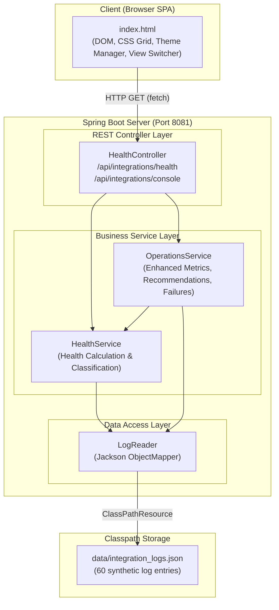
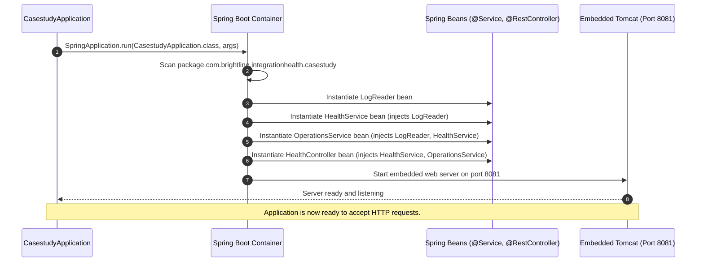
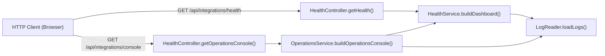
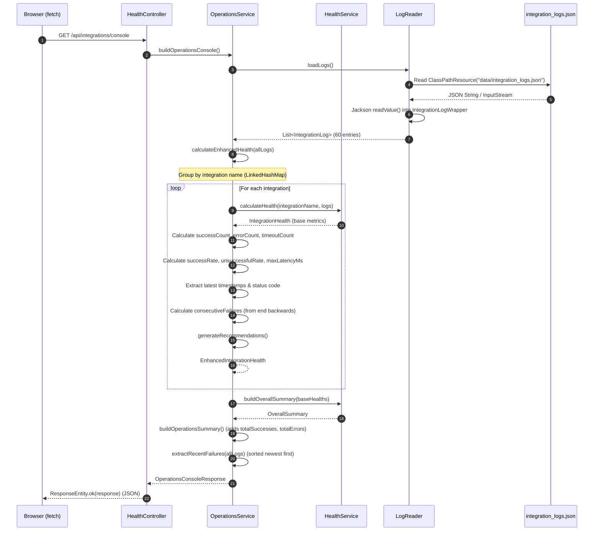
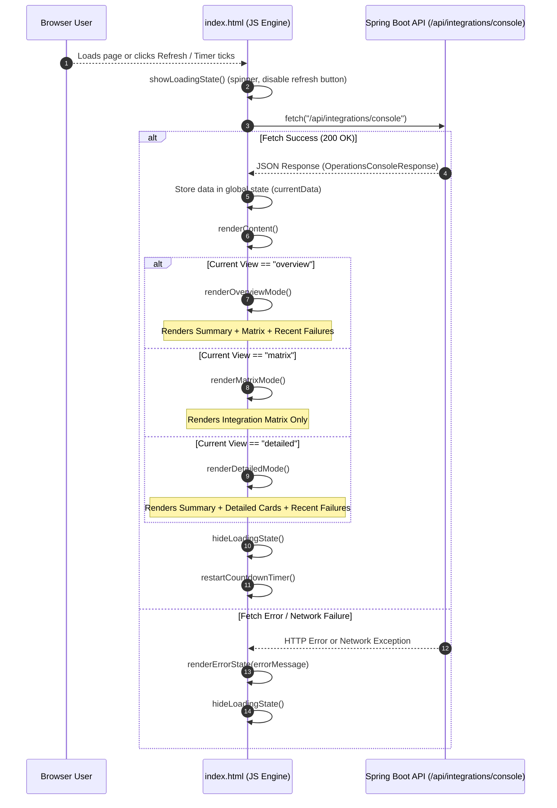
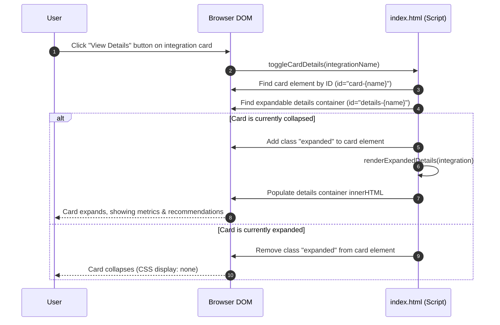
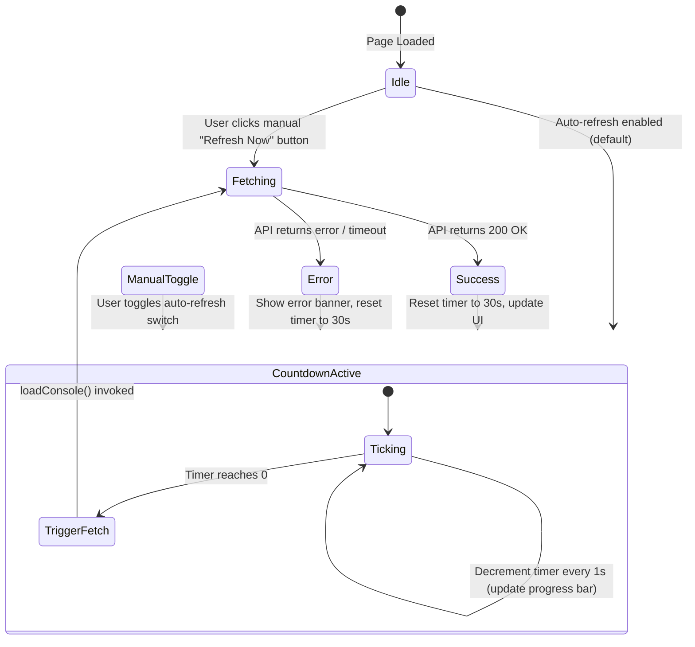
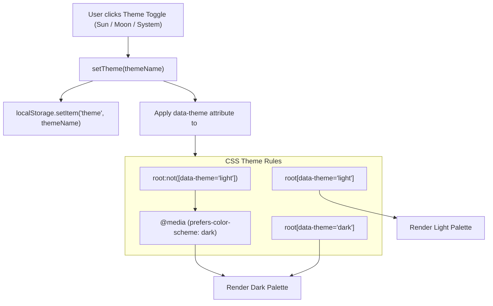
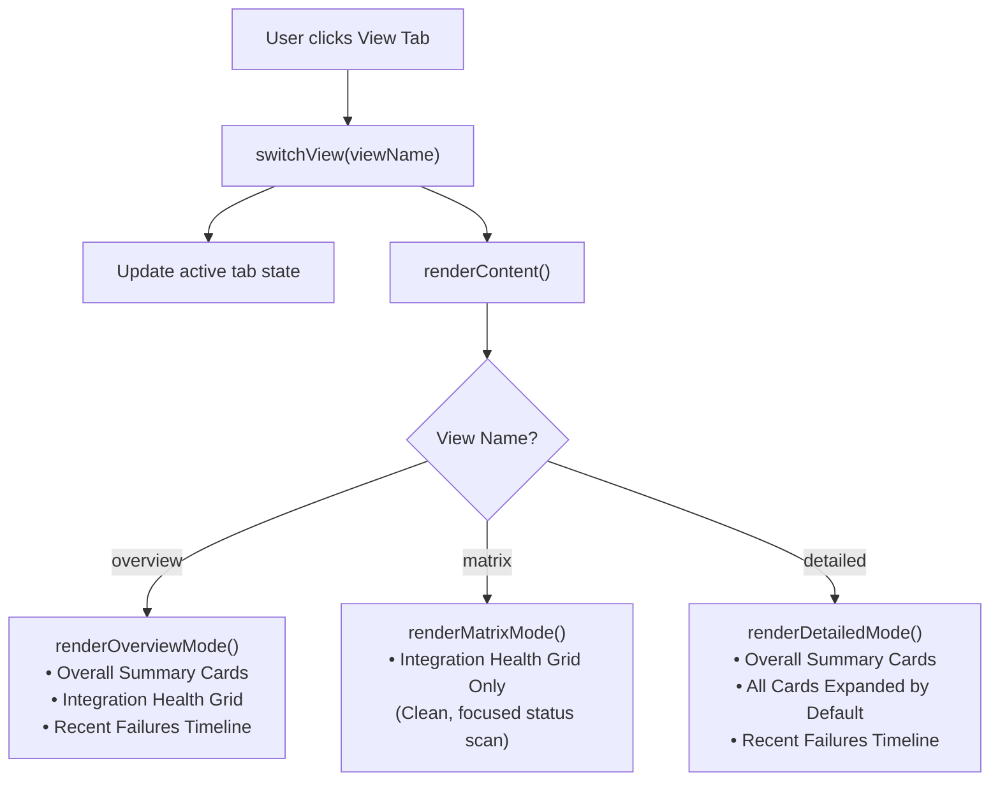
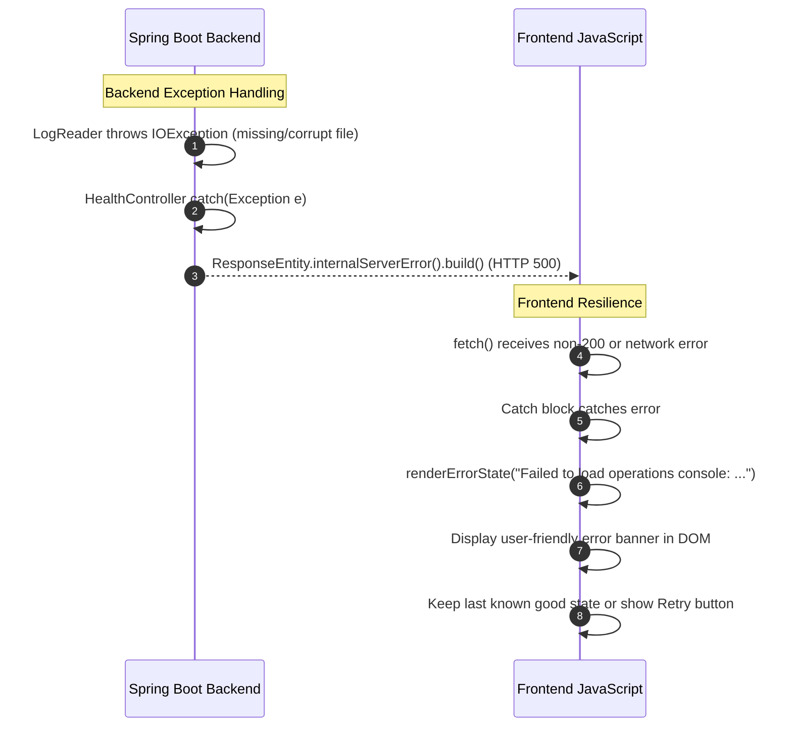

# PROJECT FLOW AND ARCHITECTURE

## Brightline HR — API Integration Health Monitoring Dashboard

> **Document type:** Architecture & Flow Guide  
> **Scope:** End-to-end system design, component interactions, execution traces, and sequence flows  
> **Constraint:** Documentation only — no source files were modified  

---

## Table of Contents

1. [System Architecture Overview](#1-system-architecture-overview)
2. [Application Startup Flow](#2-application-startup-flow)
3. [Backend Request / Response Lifecycle](#3-backend-request--response-lifecycle)
4. [Frontend Data Flow and Rendering Lifecycle](#4-frontend-data-flow-and-rendering-lifecycle)
5. [Card Rendering and Expansion Mechanism](#5-card-rendering-and-expansion-mechanism)
6. [Auto-Refresh and Manual Refresh Flow](#6-auto-refresh-and-manual-refresh-flow)
7. [Theme Switching Mechanism](#7-theme-switching-mechanism)
8. [View Switching Architecture (Overview, Matrix, Detailed)](#8-view-switching-architecture-overview-matrix-detailed)
9. [Error Handling and Resilience Flows](#9-error-handling-and-resilience-flows)
10. [File Relationship Matrix](#10-file-relationship-matrix)
11. [End-to-End Execution Trace (Example: `/console`)](#11-end-to-end-execution-trace-example-console)
12. [Key Technical Concepts and Design Patterns](#12-key-technical-concepts-and-design-patterns)

---

## 1. System Architecture Overview

The application follows a classic **Client-Server architecture** built on Spring Boot for the backend and a single-file vanilla HTML/CSS/JavaScript single-page application (SPA) for the frontend.



### Architectural Characteristics

- **Stateless Backend:** The Spring Boot backend holds no conversational state. Every request independently reads, parses, and analyzes the log dataset.
- **Embedded Static Assets:** Frontend assets (`index.html`) are served directly from Spring Boot's static resource directory (`src/main/resources/static/`), eliminating the need for a separate frontend build or hosting server.
- **Pure Client-Side Rendering:** The backend provides raw JSON payloads; the browser constructs the entire DOM dynamically.

---

## 2. Application Startup Flow

When the application starts, Spring Boot initializes the application context, configures beans, and starts the embedded Tomcat server on port `8081`.



---

## 3. Backend Request / Response Lifecycle

### 3.1 Endpoint Routing & Payload Structure

The `HealthController` exposes two REST endpoints under `/api/integrations`:



### 3.2 Detailed Sequence: `/api/integrations/console`



---

## 4. Frontend Data Flow and Rendering Lifecycle

When the user opens the page or when the auto-refresh timer fires, the frontend executes its data-fetching and rendering cycle.



---

## 5. Card Rendering and Expansion Mechanism

Each integration card in the dashboard supports a drill-down expansion to view detailed metrics and investigation recommendations.



### CSS / DOM State Transition

```
[ Collapsed State ]
  .integration-window { ... }
  .expandable-details { display: none; }
        │
        │  User clicks "View Details"
        ▼
[ Expanded State ]
  .integration-window.expanded { ... }
  .integration-window.expanded .expandable-details { display: block; }
```

---

## 6. Auto-Refresh and Manual Refresh Flow

The dashboard includes a 30-second auto-refresh countdown timer and a manual refresh button.



---

## 7. Theme Switching Mechanism

The dashboard supports three theme modes: Light, Dark, and System (auto-detected via OS preference).



---

## 8. View Switching Architecture (Overview, Matrix, Detailed)

The frontend provides three distinct operational views, controlled by the view switcher navigation bar.



---

## 9. Error Handling and Resilience Flows



---

## 10. File Relationship Matrix

This matrix maps how backend and frontend files interact across the system lifecycle.

| Source File | Interacts With | Relationship / Dependency |
|---|---|---|
| `CasestudyApplication.java` | Spring Boot Container | Entry point; boots application. |
| `HealthController.java` | `HealthService`, `OperationsService` | Controller layer; exposes `/health` and `/console` REST APIs. |
| `LogReader.java` | `integration_logs.json`, Jackson `ObjectMapper` | Data access layer; parses JSON into POJOs. |
| `HealthService.java` | `LogReader`, `IntegrationHealth`, `HealthStatus` | Core business logic; calculates health metrics and classification rules. |
| `OperationsService.java` | `LogReader`, `HealthService`, `EnhancedIntegrationHealth` | Operations business logic; computes enhanced metrics, recommendations, and failure history. |
| `IntegrationLog.java` | Jackson `ObjectMapper` | POJO mapping single log entry. |
| `EnhancedIntegrationHealth.java` | `IntegrationHealth` | Model inheritance; adds 12 operations metrics fields. |
| `index.html` | `HealthController` (`/api/integrations/console`) | Single-file frontend SPA; consumes REST API via `fetch()`. |
| `HealthServiceTests.java` | `HealthService`, `LogReader` | Unit test suite for health calculations. |
| `HealthControllerTests.java` | `HealthController`, MockMvc | Integration test suite for REST endpoints. |
| `OperationsServiceTests.java` | `OperationsService`, `LogReader`, `HealthService` | Unit test suite for operations metrics and recommendations. |

---

## 11. End-to-End Execution Trace (Example: `/console`)

The following trace traces a complete end-to-end request when an operator clicks the dashboard or the auto-refresh timer fires.

```
1. [Browser] User opens http://localhost:8081/
2. [Browser] index.html loads and executes DOMContentLoaded event listener.
3. [Browser] loadConsole() initiates fetch GET /api/integrations/console.
4. [Tomcat] HealthController.getOperationsConsole() receives HTTP request.
5. [Spring] OperationsService.buildOperationsConsole() is invoked.
6. [Service] OperationsService calls logReader.loadLogs().
7. [Disk/Classpath] LogReader opens data/integration_logs.json via ClassPathResource.
8. [Jackson] ObjectMapper parses JSON array into List<IntegrationLog> (60 objects).
9. [OperationsService] Groups logs by integration name (Slack, ADP, DocuSign, Workday, Greenhouse).
10. [Loop - 5 Integrations]:
    a. Calls healthService.calculateHealth(name, logs) -> computes base health status, error rate, latency.
    b. Calculates enhanced metrics: successCount, errorCount, timeoutCount, successRate, unsuccessfulRate, maxLatencyMs.
    c. Extracts latest request, success, and failure timestamps.
    d. Computes consecutiveFailures by iterating logs backwards from the end.
    e. Generates InvestigationRecommendations (e.g. REPEATED_500_ERRORS, RATE_LIMITING) via rule engine.
11. [OperationsService] Calls healthService.buildOverallSummary() -> aggregates totals, overall error rate, worst status.
12. [OperationsService] Computes overall successes and errors, builds OperationsSummary.
13. [OperationsService] Extracts and sorts all recent failures (newest first) with consecutive failure counts.
14. [Controller] Wraps OperationsConsoleResponse in ResponseEntity.ok() and serializes to JSON.
15. [Browser] fetch() receives 200 OK JSON response.
16. [Browser] renderContent() executes based on active view mode (Overview).
17. [Browser] DOM is updated with summary cards, integration grid, and recent failures timeline.
18. [Browser] Countdown timer resets to 30 seconds.
```

---

## 12. Key Technical Concepts and Design Patterns

### 12.1 Worst-Case Health Aggregation
The dashboard uses a hierarchical classification model (`HEALTHY` → `DEGRADED` → `UNHEALTHY`). When calculating overall status or individual integration status across multiple rules, the **worst status always wins**. For example, if an integration has a low error rate (HEALTHY) but experiences a single timeout (DEGRADED), its final status is DEGRADED.

### 12.2 Backward-Compatible API Design
The application maintains two endpoints:
- `/api/integrations/health`: Returns the legacy `DashboardResponse` model used by earlier versions or simple monitors.
- `/api/integrations/console`: Returns the extended `OperationsConsoleResponse` model containing enhanced metrics, recommendations, and failure histories.
This ensures existing consumers of `/health` are unaffected while powering the new operations console.

### 12.3 Separation of Concerns (Backend)
- **LogReader:** Pure I/O and deserialization. Knows nothing about business rules.
- **HealthService:** Pure metric calculation and threshold classification. Knows nothing about HTTP or file paths.
- **OperationsService:** Composition service that orchestrates `LogReader` and `HealthService` to build enhanced operations views.
- **HealthController:** Thin REST adapter translating HTTP requests to service calls.

### 12.4 Client-Side View State Management
The frontend maintains an in-memory application state object tracking:
- Current view mode (`overview`, `matrix`, `detailed`)
- Current theme (`light`, `dark`, `system`)
- Auto-refresh toggle state and countdown seconds
- Last fetched data payload (`currentData`)
This enables instant view switching and theme toggling without round-trips to the server.

---

*This document was generated from source code analysis only. No application files were modified.*
